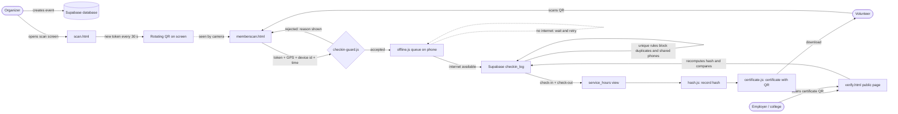

# SevaProof: System Design and Data Flow

Problem Statement 18 (TH2-PS-OI-018): Verified Volunteer Service Hours and Digital Certificates.

## 1. Problem and how the design answers it

| Challenge | Design answer |
|---|---|
| Preventing proxy check-ins | Rotating QR (30 s), location check, one check-in and out per volunteer, one phone per volunteer per event |
| Remote events with weak internet | Installable web app, offline queue, sync when online, QR checked against scan time |
| Issuing credible records | Hash of every record, public verify page, certificate with QR |

## 2. Components

- **Browser app (PWA):** `index.html`, `dashboard.html`, `member.html`, `memberscan.html`, `scan.html`, `profile.html`, `verify.html`, `challenges.html`
- **Logic:** `checkin-guard.js` (proxy and duplicate rules, hours), `offline.js` (queue), `sw.js` (offline app), `hash.js` (record hash), `qr.js` (QR), `certificate.js` (certificate export)
- **Backend:** Supabase (login, database, row-level security) through `supabase.js`
- **Database:** `setup.sql`, `setup_profile.sql`, `setup_checkin_security.sql`

## 3. Data-flow diagram

## 4. Check-in decision order

1. Is the event open (15 min before start until end)?
2. Is the QR token for this event, signed correctly and not older than about 30 s?
3. Is the volunteer within the event radius (default 150 m)? Skipped for remote events.
4. Has this volunteer already checked in (or out) of this event?
5. Has this phone already checked in a different volunteer to this event?

Any "no" stops the check-in and shows a plain-language reason (see `CheckinGuard.MESSAGES`).

## 5. Why offline check-ins are still trusted

The phone records the **scan time** with the scan. When the data syncs, the server checks the QR token against that scan time, not the sync time. A volunteer cannot scan an old code and claim it later, because the token is only valid for its own 30-second window.

## 6. Security notes

- The event secret used to sign QR tokens stays with the organizer side and the server. Do not put it in volunteer pages.
- Row-level security: volunteers read and write only their own check-ins.
- Hours are calculated by the database view, not typed in by anyone.
-