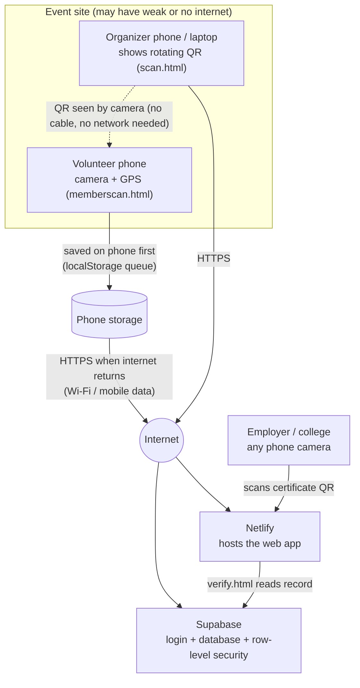

# SevaProof: Wiring / Circuit Diagram

SevaProof is a software-only prototype. No custom electronics are needed: the "wiring" is how the devices and services connect. Everything runs on the volunteers' and organizer's own phones or laptops.

## Device and service wiring

## Connections

| From | To | Link | Works offline? |
|---|---|---|---|
| Organizer screen | Volunteer camera | Light (QR code) | Yes |
| Volunteer phone | Phone storage | Browser localStorage | Yes |
| Volunteer phone | Supabase | HTTPS (REST) | No, queued until online |
| Volunteer phone | GPS | Phone sensor | Yes |
| Anyone | Netlify site | HTTPS | App opens offline after first visit (`sw.js`) |
| Verifier phone | verify.html | HTTPS | No |

## If you add hardware later

A fixed check-in kiosk can be a tablet or a Raspberry Pi with a screen showing the same rotating QR page (`scan.html`). Power it from a power bank for outdoor events and connect it to a mobile hotspot. No code change is needed.